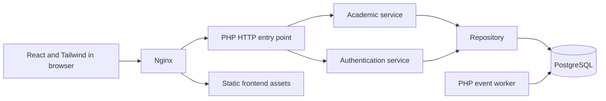

# Architecture decisions

The application follows the technologies and architectural direction in the assignment document. It is a layered monolith with a separate background worker, packaged as Docker services. The worker shares the backend code and database; separate containers alone do not make this a microservice architecture.

## Structure

**Alternatives:** keep the single Express file, use a layered monolith, or introduce independently deployed microservices.

**Decision:** separate presentation, HTTP handling, business rules, and persistence in a layered monolith. The PHP worker handles notifications asynchronously.

**Reason:** the small academic domain benefits from explicit responsibilities without service discovery, distributed transactions, or multiple repositories. The repository handles SQL; the service owns validation and capacity checks; React handles rendering.

**Consequences:** modules are easier to understand and change, but API features still deploy together and share one database. Independent service extraction can be considered when measured load or team boundaries justify it. Distribution alone does not guarantee confidentiality, integrity, or availability.

## Technology

**Alternatives:** the existing Node.js/Express backend, Java, Python, or PHP, with plain JavaScript or React for the interface.

**Decision:** React 19.3, JavaScript, Tailwind 4.3, PHP 8.4, PostgreSQL 18.6, firebase/php-jwt 7.2.1, Nginx 1.30, and Docker, matching the assignment. Node 24.21 builds frontend assets; Composer installs PHP dependencies.

**Reason:** this is the explicit technology constraint, and each component has a defined responsibility. PHP-FPM serves the API behind Nginx; the production frontend is static.

**Consequences:** the project needs two dependency ecosystems, but Docker contains both. Committed npm and Composer lockfiles make dependency resolution reproducible. Image tags should be promoted to tested immutable digests for controlled production releases.

## Data

**Alternatives:** process memory, relational storage, or a document-oriented NoSQL database.

**Decision:** PostgreSQL with foreign keys, unique enrollments, integer constraints, generated identifiers, and a persistent Docker volume.

**Reason:** students, courses, accounts and enrollments have explicit relationships. A transaction locks the target course before checking its remaining capacity and recording the enrollment and event.

**Consequences:** data survives process restarts, duplicates are rejected, and concurrent API requests cannot overbook a course. Capacity is an application transaction rule; direct administrative database writes must preserve it. The database is a shared dependency that requires backups and monitoring.

## Communication

**Alternatives:** REST only, synchronous notification calls, or message-driven integration through a broker.

**Decision:** same-origin JSON REST requests plus a PostgreSQL transactional event table. Successful enrollments insert `enrollment.created` in the same transaction. A worker polls every two seconds and writes in-app notifications for administrators and the affected student's account.

**Reason:** enrollment must succeed independently of notification rendering, without introducing a broker absent from the required stack. `FOR UPDATE SKIP LOCKED` permits multiple workers; a unique event/user key prevents duplicate notifications.

**Consequences:** notifications are eventually consistent and require refresh in the browser. Database rollback leaves failed events pending. No external email, course-assignment or task notifications are claimed. A future broker can consume the persisted events when required.

## Deployment

**Alternatives:** install each runtime on a physical server, deploy all containers on a university server, or use cloud infrastructure.

**Decision:** Docker Compose on a single university-owned server or Linux virtual machine. Document a cloud recovery path using the same images and database backups.

**Reason:** this can reuse institutional infrastructure and keeps local and server environments similar. It does not require a provider-specific service.

**Consequences:** a single host remains a single point of failure. The supplied configuration is a local demonstration; public operation needs HTTPS, restricted credentials, backups and operational ownership. Cloud redundancy is a deployment extension, not an implemented feature.

## Authentication and authorization

**Alternatives:** no authentication, server-side cookie sessions, or signed JWTs.

**Decision:** JWTs signed with HS256, an explicit algorithm allowlist, issuer/audience validation, one-hour expiration, password hashing, and a database-backed token revocation list. The browser stores the token only in memory. The server loads current roles from the database on each authenticated request.

**Reason:** JWT is required by the document, while server-side checks prevent a hidden frontend control from becoming the only authorization boundary. Logout both clears the browser token and blocks its reuse.

**Consequences:** users sign in again after reload; the database is consulted for authorization and revocation, so authentication is not fully stateless. Administrators can create academic records, instructors can read their assigned courses and the corresponding rosters, and students can access only their own personal records and enroll only themselves. Students can also read classmates in courses where they are enrolled. Instructor catalog, student, enrollment and report reads are scoped to assigned courses. See [role interfaces](role-interfaces.md).

## Quality attributes and limits

| Attribute               | Implemented evidence                                                | Limit                                                                  |
| ----------------------- | ------------------------------------------------------------------- | ---------------------------------------------------------------------- |
| Modularity and cohesion | HTTP, services, repository, reusable React components               | Small application; no dependency injection framework                   |
| Maintainability         | English naming, lockfiles, documented contracts, integration checks | Versioned migrations run before API startup                            |
| Integrity               | Transactions, course locks, uniqueness and foreign keys             | Direct database administration bypasses service rules                  |
| Confidentiality         | Role and ownership checks, password hashes, JWT validation          | HTTPS is required outside localhost                                    |
| Availability            | Restart policies, database/web health checks, persistent volume     | No replication or automated failover                                   |
| Scalability             | Stateless PHP request handling and concurrent worker locks          | Reads have no pagination; single database; load testing still required |
