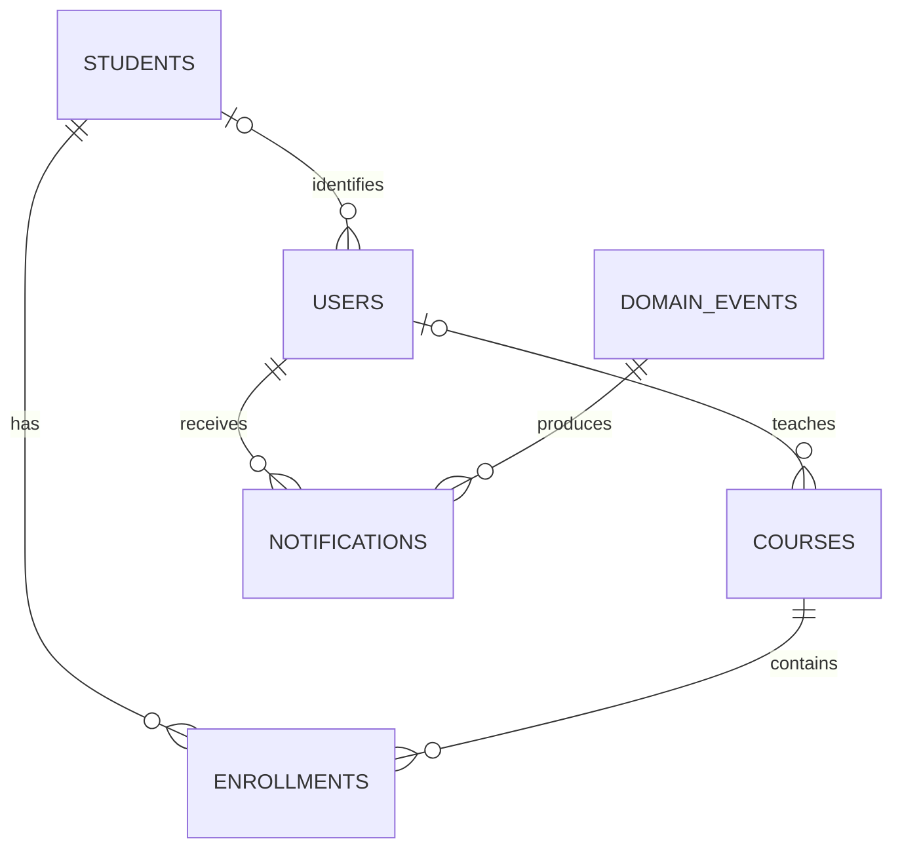

# Data model and demo records

## Hard-coded data

Hard-coded demonstration data is centralized in `backend/bin/seed.php`. The frontend contains no student/course arrays or fallback records. The seed command writes the examples into PostgreSQL; all normal reads and writes use the database.

| Student     | Major                  | Semester |
| ----------- | ---------------------- | -------- |
| Ana Torres  | Software Engineering   | 8        |
| Luis Perez  | Software Engineering   | 8        |
| Maria Gomez | Information Technology | 6        |

| Course                | Instructor  | Capacity |
| --------------------- | ----------- | -------- |
| Software Architecture | Carlos Ruiz | 30       |
| Databases             | Laura Vera  | 25       |
| Web Development       | Pedro Leon  | 35       |

Initial enrollments: Ana Torres in Software Architecture and Databases; Luis Perez in Software Architecture. These preserve the original demonstration relationships. Seeded records do not emit notification events; newly created enrollments do.

The three example accounts are `admin@example.edu`, `instructor@example.edu`, and `student@example.edu`. The student account is linked to Ana Torres. All use the configured `DEMO_PASSWORD`, hashed with PHP `password_hash`; no plaintext password is stored in PostgreSQL. These are demonstration identities, not a real university directory.

Seeding is explicit and transactional. It skips when accounts already exist, and rejects a partially populated academic database without accounts. Repeated seeding does not overwrite user changes. It is intended for a fresh demonstration database, not production account administration.

## Relationships

- `students`: name, major, semester (1–12).
- `courses`: name, instructor display name, capacity (1–1000). The legacy instructor name remains as a display fallback. `instructor_user_id` references the assigned instructor account and controls access; only administrator assignment grants that access.
- `enrollments`: student/course foreign keys and a unique pair.
- `users`: unique email, password hash, role, optional student link. Student-role accounts require a student link.
- `domain_events`: enrollment payload, creation time and processing time.
- `notifications`: user/event links and a message; each user receives an event at most once.
- `revoked_tokens`: token identifier and expiry for logout enforcement; expired entries are cleaned during logout.

The schema is in `database/001-schema.sql`. Generated IDs are not derived from array lengths. The PostgreSQL 18 volume mounts at `/var/lib/postgresql`, following the [official image layout](https://hub.docker.com/_/postgres).
