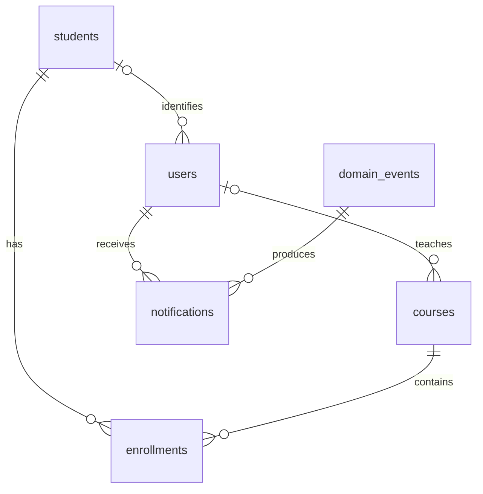

# Role interfaces

All screens and API fields remain in English.

| Role          | Screen                | Behavior                                                           |
| ------------- | --------------------- | ------------------------------------------------------------------ |
| Student       | My courses            | Cards for courses in which the authenticated student is enrolled   |
| Student       | Enrolled students     | Classmates in an enrolled course, with search and a refresh action |
| Instructor    | Assigned courses      | Cards for courses assigned to the authenticated instructor account |
| Instructor    | Enrolled students     | Student roster for an assigned course                              |
| Administrator | Student enrollment    | Select a student and course, then save the enrollment              |
| Administrator | Enrolled students     | Select any course to view and search its roster                    |
| Administrator | Courses & assignments | Create courses and assign an existing instructor account           |

A course card opens the corresponding roster. Empty course lists and empty rosters have explicit messages. A roster contains only student ID, name, major and semester; it does not reveal credentials or email addresses.

## Assignments and access

`courses.instructor_user_id` references `users.id`. A course may have no assigned account or one assigned instructor; one instructor can teach multiple courses. The assignment endpoint accepts only users with the `instructor` role. The original `instructor` display name is preserved for existing unassigned courses; typing a name alone does not grant access to a user account.

The administrator can change the assignment in **Courses & assignments**. Access checks use the database assignment on every request. Students can request a roster only when enrolled in that course, and instructors only when assigned to it. Direct requests for other course rosters return 403. Instructor access to the older student, enrollment, course and report endpoints is also restricted to assigned courses.

The previous self-enrollment API remains available for compatibility. The new student interface focuses on enrolled courses and classmates; enrollment entry is presented in the administrator interface.

## Migration and demonstration

Docker Compose runs `php bin/migrate.php` before starting the API and worker. Versioned SQL files in `database/migrations` are applied in a transaction with an advisory lock and recorded in `schema_migrations`. Existing student and enrollment data is retained. Do not delete the database volume.

Migration 002 links the existing demonstration Software Architecture course to `instructor@example.edu` (Carlos Ruiz). Fresh seeding creates the same assignment. Other legacy courses require an explicit administrator assignment; no account is inferred from an instructor's display name.

Demo logins use the configured `DEMO_PASSWORD`:

- Student: `student@example.edu` (Ana Torres).
- Instructor: `instructor@example.edu` (Carlos Ruiz).
- Administrator: `admin@example.edu`.

## API additions

| Method | Path                         | Description                                                                             |
| ------ | ---------------------------- | --------------------------------------------------------------------------------------- |
| GET    | /api/my-courses              | Enrolled courses for students; assigned courses for instructors; all courses for admins |
| GET    | /api/courses/{id}/students   | Authorized roster; 403 when the course is outside the user's scope                      |
| GET    | /api/instructors             | Administrator-only list of instructor IDs and names                                     |
| POST   | /api/courses/{id}/instructor | Administrator assignment using `{ "instructorId": 2 }`; 200 on success                  |

Invalid instructor IDs or non-instructor accounts return 422. A missing course on assignment returns 404. Unauthorized assignments return 403.

